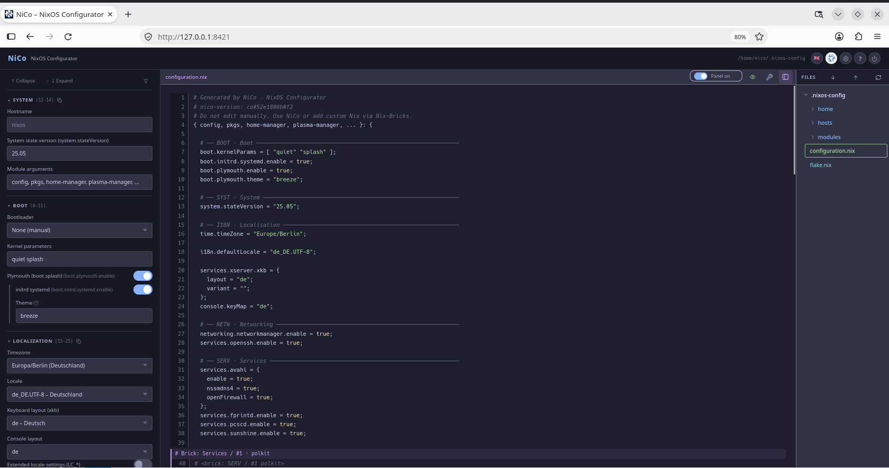
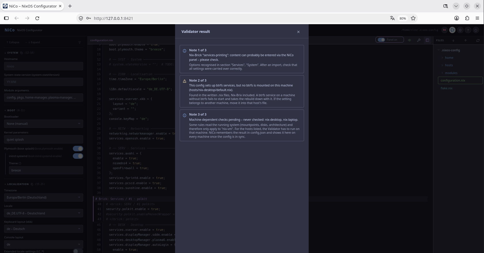
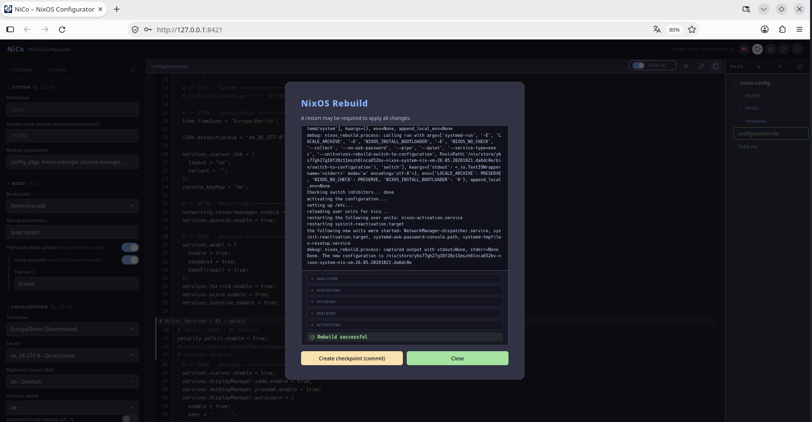

# NiCo – NixOS Configurator

> ⚠️ NiCo works — I use it myself to manage my machines.
> Still, I recommend making a backup of your config first, or letting NiCo work on a copy in a separate directory.
> That way you can verify that your config is processed correctly and a dry-run passes.

NiCo is a local, browser-based GUI editor for NixOS configurations. It reads and writes your real `.nix` files directly — no database, no intermediate format, no hidden state. Everything it generates stays a normal Nix file that works without NiCo.

Built by a non-developer using Claude Code and OpenAI Codex as an experiment in AI-assisted development.

Feedback and discussion: https://discourse.nixos.org/t/nico-nixos-configurator/77117



*Form fields on the left, the file they produce on the right — and a Nix brick in it, the part NiCo never touches.*

<details>
<summary>Two more screenshots: the Validator and a rebuild</summary>



*The Validator runs before every build. This one found a btrfs service on a machine that has no btrfs — the config builds, the service fails at start and takes the rebuild down with it.*



*`nixos-rebuild` from inside NiCo, with its phases and its live output — and the offer to create a checkpoint afterwards.*

</details>

---

## The core idea: Nix-Brix

Most GUI config tools only allow what their forms cover. NiCo takes a different approach: anything it doesn't have a form field for, you write as a **Nix brick** — a free Nix section wrapped in marker comments that NiCo **never touches**. Form fields and hand-written Nix coexist in the same file. When importing an existing config, unrecognized sections are preserved as bricks automatically — nothing is ever discarded.

This has one important consequence: every time you write, NiCo regenerates the form-managed file completely from its current state instead of patching the existing text. Nix bricks are copied over unchanged, but comments, blank lines and manual formatting **outside** of Nix bricks are not preserved — they disappear with the next write. Only content inside a Nix brick is safe from being overwritten, so put anything you want to keep verbatim into a brick.

---

## Features

- **Import existing configs** – from a directory or ZIP; recognized options become form fields, everything else is preserved as Nix bricks, with automatic backups
- **Split-panel editor** – edit options on the left, see the resulting `.nix` file live on the right
- **Nix-Brix** – free Nix sections NiCo never modifies: create, rename, move, split them across hosts and modules
- **Hardware check** – a config that comes from somewhere else describes somebody else's disks, and a build from it looks for devices that do not exist. NiCo compares the `hardware-configuration.nix` against the devices actually present on this machine and asks before anything is built — after an import, after a restore, and at start, because a config brought in with `git clone` passes no dialog at all. On a multi-host config only the file of the host that *is* this machine is ever touched
- **Validator** – 38 configurable rules, run by itself before every build on the state written to disk. Hints and warnings never interrupt; a critical error brings its findings up instead of starting the build. It catches what Nix only reports halfway through a rebuild, and some things Nix never reports at all: a `system.stateVersion` newer than the installed release, a user the rebuild would create without a password or an SSH key, uid and gid collisions with accounts that already exist, missing imports, duplicate attributes, btrfs maintenance on a machine without btrfs, a swapfile inside a snapshotted subvolume
- **Dry-run & rebuild** – run `nixos-rebuild dry-build` / `switch` directly from NiCo with live streaming output, and a report of the services that failed afterwards, each with the last lines of its journal. Only services that were healthy before that build are listed, so what a desktop carries around anyway stays out of it
- **Crash-safe writes** – every config file is written to a temporary file, flushed to the disk and then renamed into place. A reset or a power cut leaves either the complete old file or the complete new one, never a truncated `configuration.nix` that no longer parses
- **Git integration** – a checkpoint after every write and before every rebuild, restore to any earlier checkpoint ("time machine"), remote push, a guard that detects changes made outside NiCo before writing, and a size guard that keeps an oversized file out of the history instead of blocking every future push
- **Foreign-file guard** – files that don't belong to the config are detected; decide per file whether git tracks or ignores them
- **Flake & Home Manager support** – multi-host flakes with channel and architecture selection; per-user Home Manager files
- **Maintenance & snapshots** – systemd timers for disk health (`smartd`) and `/tmp` cleanup on any machine, plus btrfs auto-scrub and auto-balance where btrfs is actually mounted
- **Detach anytime** – one click removes all NiCo markers and leaves a plain Nix config (with a ZIP backup)
- **Help system** – built-in help (German/English), tooltips, and wiki links
- **Multi-language** – UI in EN, DE, ES, FR, JA, RU, ZH
- **Local only** – binds to `127.0.0.1`, no telemetry; the only network access is an optional read-only fetch of the public nixpkgs channel list

---

## Requirements

- NixOS
- A browser

Nothing else — Nix fetches what NiCo needs. Only the from-source route uses
`shell.nix` directly.

---

## Getting Started

Just try it — this installs nothing and leaves nothing behind:

```bash
nix run github:DSpayreR6/nico
```

On a fresh NixOS installation flakes are still disabled. Then use:

```bash
nix --extra-experimental-features 'nix-command flakes' run github:DSpayreR6/nico
```

NiCo picks a free port (default `8421`) and opens your browser automatically.

### Not sure which command is yours?

There is a small menu that offers them all — try, install, update, and the same
two for the development branch:

```bash
sh <(curl -sL https://raw.githubusercontent.com/DSpayreR6/nico/main/install.sh)
```

It adds the flake flags above by itself when your machine needs them, and it
prints every command in full before running it, so you can see what it does and
type it yourself next time. Read it first if you prefer — it is a single short
shell script:

```bash
curl -sL https://raw.githubusercontent.com/DSpayreR6/nico/main/install.sh | less
```

### Keep it installed

```bash
nix profile install github:DSpayreR6/nico
```

This gives you the `nico` command and an entry in your application menu.
Update it later with `nix profile upgrade nico`.

Nix 2.34 renamed `nix profile install` to `nix profile add`. Both still work —
the old name only prints a deprecation warning — but older Nix versions do not
know `add` yet, which is why the command above uses `install`. The install
menu picks whichever name your Nix has.

Or declare it in your own flake, so it travels with your config to your other
machines:

```nix
{
  inputs.nico.url = "github:DSpayreR6/nico";

  outputs = { self, nixpkgs, nico, ... }: {
    nixosConfigurations.myhost = nixpkgs.lib.nixosSystem {
      system = "x86_64-linux";
      modules = [
        ./configuration.nix
        { environment.systemPackages = [ nico.packages.x86_64-linux.default ]; }
      ];
    };
  };
}
```

Update it with `nix flake update nico` and a rebuild — NiCo can do that rebuild
for you.

### From source

For development, or to read the code before running it:

```bash
git clone https://github.com/DSpayreR6/nico.git
cd nico
./start.sh
```

### Testing version

Every command above gives you the released version from the `main` branch.
Work in progress lives on `dev` and carries a `-dev` version number:

```bash
nix run github:DSpayreR6/nico/dev --refresh
```

Use it to try a fix before it is released, or when a bug report asks you to.
It is not meant for everyday use — it may change or break at any time, and the
`--refresh` is needed because Nix otherwise serves a cached copy of the branch.

---

## Status

NiCo manages my own machines and is at version 0.14.0. Every change runs
through a headless roundtrip over 18 real-world configurations taken from
public repositories — imported, written back, and checked that nothing was
lost — plus rule tests for the Validator, the git layer and the import paths.
Releases are tried in a virtual machine first, by importing a config from
another machine and booting the result.

That said, it is still a young tool and the edges show. If something goes
wrong, the config is what matters, not NiCo — which is why there is a backup
before every import, a checkpoint before every write, and a one-click way out
that leaves plain Nix behind.

Contributions, bug reports, and feedback are welcome. Please keep in mind I'm
only one person, so responses may take some time.

---

## License

MIT
